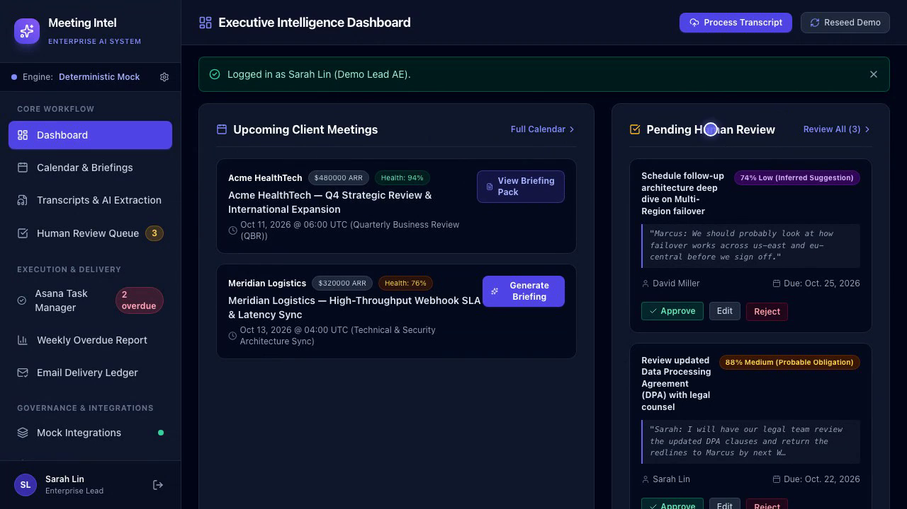
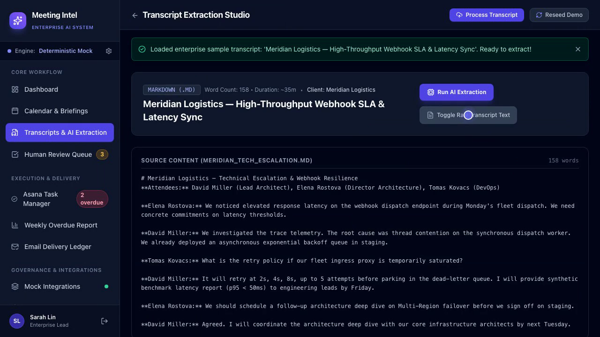
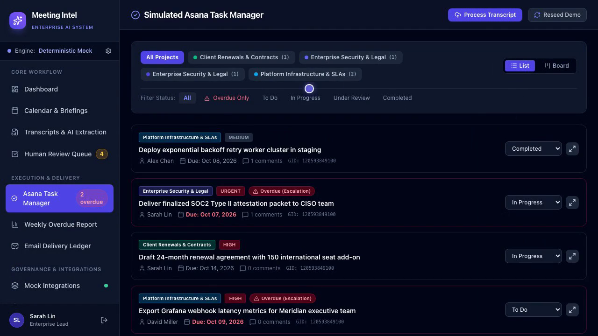
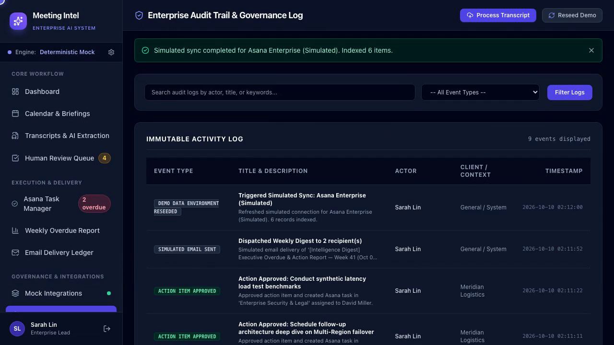

# Meeting Intelligence — AI Meeting Preparation & Action Tracking System

An enterprise-grade, portfolio-ready meeting intelligence platform built with **Django**, **HTMX**, **Tailwind CSS**, and **SQLite**.

The system automates the entire executive meeting lifecycle: synthesizing pre-meeting briefing dossiers from client history and emails, extracting decisions and action items from transcripts with supporting quotes and confidence scores, enforcing human-in-the-loop approval before task creation, managing simulated Asana boards, and compiling weekly executive overdue reports with simulated email delivery.

---

## 🎯 Key Capabilities & Feature Matrix

1. **Executive Intelligence Dashboard**: Real-time snapshot of upcoming client meetings, pending triage queue items, open Asana tasks, overdue escalations, and system audit logs.
2. **Simulated Google Calendar**: Interactive agenda view of scheduled client engagements with metadata (ARR, account tier, health score, attendees, mock Google Meet links).
3. **Pre-Meeting Briefing Dossiers**: Autonomous synthesis aggregating client ARR, renewal timelines, recent Gmail communications, relationship health, stakeholder analysis, talking points, traps to avoid, and anticipated risks.
4. **Transcript Processing Studio**: Ingest `.vtt`, `.md`, or `.txt` transcripts (or choose pre-built enterprise samples). Extracts structured summaries, ratified decisions, proposed assignees, due dates, confidence scores, and verbatim supporting excerpts.
5. **Human Approval Gate**: Strict review interface to edit, approve, or reject proposed actions. **Guaranteed Guardrail:** Never creates an external task without human approval or silently invents deadlines/owners without explicit confidence flags.
6. **Simulated Asana Task Manager**: Realistic task management with projects, list and Kanban board views, priority badges, overdue tracking, status changers, and discussion comments.
7. **Weekly Overdue & Accountability Digest**: Generates structured Markdown and HTML executive reports tracking overdue actions, upcoming deadlines, and completed milestones.
8. **Simulated Email Delivery Ledger**: One-click outbound SMTP email dispatcher with simulated MTA response codes (`250 2.0.0 OK: queued`) and complete audit history.
9. **Simulated Integrations Panel**: Clear, labeled mock connections for Google Calendar, Gmail Workspace, and Asana Enterprise with zero external credential requirements.
10. **Immutable Audit Trail & Demo Controls**: Full event ledger of all AI operations and 1-click demo database reseeding.

---

## 🏗️ Architecture & Service Layer Design

The application follows a clean service layer architecture separating domain logic from Django views:

```
meeting_intelligence/
├── config/                      # Django Project Settings & Root Routing
│   ├── settings.py
│   ├── urls.py
│   └── wsgi.py
├── intelligence/                # Core Meeting Intelligence Application
│   ├── models.py                # Rich Domain Models (Clients, Meetings, Transcripts, Tasks, Audits)
│   ├── views.py                 # Clean HTTP & HTMX Endpoints
│   ├── forms.py                 # Type-Safe Forms with Tailwind Styling
│   ├── urls.py                  # Namespaced URL Definitions
│   ├── context_processors.py    # Global Badges & AI State
│   ├── services/
│   │   ├── ai_client.py         # Pydantic Schemas, Gemini Client & Deterministic Mock Provider
│   │   ├── briefing_service.py  # Pre-Meeting Context Aggregation & Dossier Synthesis
│   │   ├── transcript_service.py# VTT/MD Parser, AI Extraction & Idempotency
│   │   ├── task_service.py      # Human Approval Gate & Asana Task Synchronization
│   │   ├── report_service.py    # Weekly Overdue Metrics & Simulated SMTP Dispatch
│   │   ├── integration_service.py# Mock Connector Health & Synchronization
│   │   └── seed_service.py      # Enterprise Demo Data Seeder
│   └── tests.py                 # Automated Test Suite (Zero Network / Zero External API Dependency)
└── templates/                   # Tailwind & HTMX Templates
    ├── base.html                # Master Responsive Enterprise Layout
    └── intelligence/            # Domain Views & HTMX Partials
```

---

## ⚡ Quick Start Guide

### 1. Prerequisites
- Python 3.11+ (Tested on Python 3.13)
- SQLite (included with Python standard library)

### 2. Setup Virtual Environment & Install Dependencies
```bash
# Clone or navigate to the repository
cd meeting_intelligence

# Create virtual environment
python3 -m venv .venv
source .venv/bin/activate

# Install requirements
pip install -r requirements.txt
```

### 3. Run Migrations & Seed Demo Data
```bash
python manage.py migrate
python manage.py seed_demo_data
```

### 4. Run Automated Tests
```bash
python manage.py test
```
All tests execute in deterministic mode without network access or third-party keys.

### 5. Launch Development Server
```bash
python manage.py runserver
```
Open **[http://127.0.0.1:8000/](http://127.0.0.1:8000/)** in your browser.

---

## 🔑 Demo Access & Credentials

- **Quick 1-Click Login:** Click the **"Sign In as Sarah Lin (Demo AE)"** button on the login screen.
- **Manual Credentials:**
  - **Username:** `demo`
  - **Password:** `demo1234`

---

## 🔄 End-to-End Walkthrough

1. **Dashboard & Calendar**:
   - Navigate to `/calendar/` to view upcoming meetings for **Acme HealthTech**, **Meridian Logistics**, and **Aura Fintech**.
   - Click **"View Briefing Dossier"** or **"Generate AI Briefing"** on any scheduled meeting.
2. **Pre-Meeting Intelligence**:
   - Inspect the generated dossier covering commercial ARR, renewal risk, attendee motives, talking points, and email history.
   - Click **"Inspect AI Prompt & JSON"** to view the validated Pydantic schema.
3. **Transcript Processing Studio**:
   - Navigate to `/transcripts/`.
   - Select the pre-built **"Meridian Logistics — High Throughput Webhook Latency (Markdown)"** sample or upload your own `.vtt`/`.md`/`.txt` file.
   - Click **"Run AI Extraction"** to parse decisions, action items, confidence levels, and verbatim quotes.
4. **Human-in-the-Loop Review Queue**:
   - Navigate to `/approvals/`.
   - Review proposed action items. Note the confidence score and verbatim quote proof.
   - Click **"Approve"** to create a live Asana task, or click **"Edit Details"** to modify the owner/due date first.
5. **Asana Task Manager**:
   - Navigate to `/tasks/`.
   - Switch between **List View** and **Kanban Board View**.
   - Filter by **"Overdue Only"** to see escalated tasks.
   - Open any task drawer to view its discussion comments and origin quote.
6. **Weekly Overdue Digest & Simulated Email Delivery**:
   - Navigate to `/reports/weekly/`.
   - Review the compiled executive markdown synthesis.
   - Click **"Dispatch Simulated Weekly Report Email"** to test outbound SMTP delivery logging.

---

## ⚙️ AI Engine Configuration (Gemini & Deterministic Mock)

By default, the application runs with the **Deterministic Mock Engine**, generating repeatable, realistic enterprise intelligence without external network calls.

### Optional Gemini API Setup:
To enable live AI processing with the Gemini API:
1. Create a `.env` file in the root directory:
   ```env
   GEMINI_API_KEY=your_gemini_api_key_here
   AI_MODE=gemini
   GEMINI_MODEL=gemini-1.5-pro
   ```
2. Or toggle the provider directly inside the app under **Demo Controls & Settings** (`/demo-controls/`).

> **Automatic Fallback Guarantee:** If the Gemini API times out, returns malformed data, or the key is omitted, the application seamlessly falls back to the deterministic mock provider with clear audit logging.

---

## 🛡️ Limitations & Guardrails

- **Zero Outbound Spam / Zero Unverified Tasks:** Action items are never committed to Asana before explicit human verification.
- **No Inferred Hallucinations:** Items where the speaker did not explicitly commit to a date/owner are flagged with the `Inferred Context` badge.
- **No External Infrastructure Required:** The application is entirely self-contained (no Celery, Redis, or external message brokers required).


## 🖼️ Application Screenshots

| Executive Meeting Dashboard | Executive Briefing & Key Decisions |
|:---:|:---:|
|  |  |
| *Multi-meeting analytics, sentiment trends, & topic overview* | *AI-synthesized summaries, risks, & critical takeaways* |

| Interactive Transcript & Speaker Diarization | Task & Action Item Integration |
|:---:|:---:|
|  |  |
| *Timestamped speaker breakdown with search & entity tagging* | *Automated action item extraction and Asana/Linear export* |
